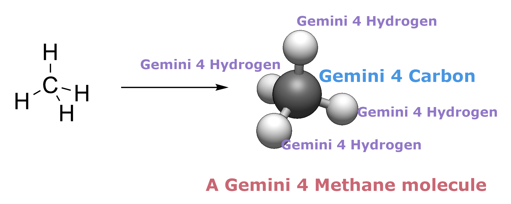

# ⚗ Gemini Molecule Builder

> If you have a Gemini 4 Carbon with 4 Gemini 4 Hydrogen as subagent, then you have Gemini 4 methane.



> ## 🤡 Disclaimer — read this first
>
> **This is a joke.** The configuration file will not be able to be used, nor does the topology make any sense.

A ~400-line Python gag that compiles any **SMILES** string into a
**Gemini 4 multi-model topology config (YAML)**, using the premise that if a
model line is named after chemical elements, then a molecule *is* a
multi-agent system:

## Install

Requires Python 3.8+ and RDKit (the only honest part of the pipeline):

```bash
pip install rdkit
```

## Usage

```bash
python3 gemini_compose.py C                                   # Gemini Methane (the classic)
python3 gemini_compose.py O                                   # Gemini Water: oxygen hub + 2 hydrogen interns
python3 gemini_compose.py CCO -o ethanol.yaml --mermaid ethanol.mmd
python3 gemini_compose.py CN1C=NC2=C1C(=O)N(C(=O)N2C)C --no-h # Gemini Caffeine, hydrogens unmasked
python3 gemini_compose.py "[Na+].[Cl-]"                       # federated cluster, zero mutual trust
python3 gemini_compose.py "[Ar]"                              # single-model org that does nothing
python3 gemini_compose.py U                                   # hazmat incident
python3 gemini_compose.py --list-elements                     # the full unreleased lineup
```

Output: an org-chart YAML (plus optional standalone Mermaid diagram) and an
assembly banner like:

```text
⚗  Assembled Gemini Methane
   1x gemini-4-carbon + 4x gemini-4-hydrogen
   hub: C1 | submodels: 4 | councils: 0 | budget: 8212 tokens | temp: 0.7
```

## Chemistry → org mapping

| Molecule feature          | Org feature                                                        |
| ------------------------- | ------------------------------------------------------------------ |
| atom                      | a `gemini-4-<element>` instance, with element-flavored persona       |
| terminal atom             | `worker` — a leaf sub-model with exactly one channel                |
| highest-degree atom       | `orchestrator` (ties broken by atomic mass; nitrogen has won elections) |
| degree 2 / degree ≥ 3     | `router` / `sub-orchestrator`                                       |
| single bond               | 1x delegation channel                                               |
| double bond               | dual-lane 2x channel                                                |
| triple bond               | **hyperchannel 3x** — shares one context window; divorce not supported |
| aromatic bond             | `kind: resonate` — output delocalized, no attribution to any atom   |
| ring                      | debate council, `max_rounds = ring size` (runaway councils are fission incidents) |
| disconnected SMILES       | `topology_mode: federated` — ionic links, no shared context, only electrostatic vibes |
| molecular weight          | `budget_tokens` (512 tok/g)                                         |
| formal charge             | temperature shift (cationic drama / anionic passivity)              |
| isotope `[13CH4]`         | `gemini-4-carbon-13`, isotope-stable checkpoint build               |

Roles, channels, councils, and policies all follow a typed-graph spec
(agents / edges / policies) — the structure is a legitimate multi-LLM
topology format wearing a lab coat.

## Sample output (abridged)

`gemini_methane.yaml` — compile with `python3 gemini_compose.py C -o gemini_methane.yaml`:

```yaml
group: gemini-methane
display_name: "Gemini Methane"
tagline: "One Carbon, four Hydrogen workers. The hello-world of Gemini orgs."
org_size: 5
topology_mode: hub-and-spoke
budget_tokens: 8212     # 16.04 g/mol x 512 tok/g
final_authority: C1

agents:
  - id: C1
    model: gemini-4-carbon
    role: orchestrator
    persona: "Tetravalent backbone of life and schemas alike. Will bond with anything load-bearing."
    valence_channels: 4
  - id: H2
    model: gemini-4-hydrogen
    role: worker
    persona: "Tiny, abundant, attaches itself to anything. One channel, zero ambition."
    valence_channels: 1
  # ... H3, H4, H5, all equally content

edges:
  - {from: C1, to: H2, kind: delegate, channel: single, bandwidth: 1x}
  # ... one per C–H bond

policies:
  max_hierarchy_depth: 1
  delegation_rule: every hydrogen owns exactly one channel — delegate once, never retask
```

## Notable assemblies

- **Gemini Water (`O`)** — oxygen hub, two hydrogen interns; universal solvent for prompts.
- **Gemini Benzene (`c1ccccc1`)** — six-seat aromatic council whose consensus is a resonance hybrid; nobody may claim authorship.
- **Gemini Caffeine** — two fused councils and a nitrogen caucus; *this org chart wrote your thesis*. The hub election produced a nitrogen.
- **Gemini Table Salt** — fully ionized federation, zero mutual trust.
- **Gemini Argon (`[Ar]`)** — one inert model, no edges, ships unreviewed because nothing happens.
- **Gemini Uranium (`U`)** — policy warning: *may sustain chain-of-thought without further prompting.*

## Known "issues" (all features)

- TNT assembles fine; the safety review still says no.
- Lead agents may only be removed during a scheduled outage. The outage has never been scheduled.
- Molecules larger than `C₃₀` produce org charts larger than any org should have. Use `--no-h` to keep the hydrogen interns implicit.
- The generated YAML is syntactically valid. Resist the urge to feed it to a real orchestrator. Resist.

## License

Do whatever you want with it, it's a joke. 
